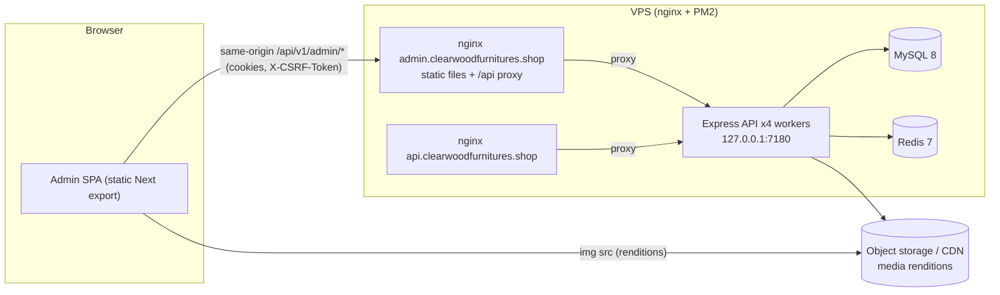

# ClearWood Admin — Architecture

Status: **proposal for review** (Phase 2 deliverable). No application code has been written.
Companion documents: [ADMIN_INFORMATION_ARCHITECTURE.md](ADMIN_INFORMATION_ARCHITECTURE.md) ·
[ADMIN_API_COVERAGE.md](ADMIN_API_COVERAGE.md) · [ADMIN_ROLE_PERMISSION_MATRIX.md](ADMIN_ROLE_PERMISSION_MATRIX.md) ·
[ADMIN_WORKFLOWS.md](ADMIN_WORKFLOWS.md) · [ADMIN_COMPONENT_SYSTEM.md](ADMIN_COMPONENT_SYSTEM.md) ·
[ADMIN_STATE_AND_ERROR_MODEL.md](ADMIN_STATE_AND_ERROR_MODEL.md) · [ADMIN_DEPLOYMENT_PLAN.md](ADMIN_DEPLOYMENT_PLAN.md)

---

## 1. Evidence base

Everything below was derived from the repositories on this machine. Nothing was invented; where a
fact could not be established it is marked **UNKNOWN**.

| Source | Location | What was used |
| --- | --- | --- |
| Backend repo | `Desktop/clearwood-backend-repo` @ `2fa6db0` for the analysis (2026-09-25 15:07 IST); **re-synced to `b5861fd`** ("api fix", 2026-09-25 18:12 IST, clean tree) for implementation | routes, controllers, services, middleware, `shared/` schemas/enums/types, seed data, env schema, infra runbook, `docs/PROJECT_CONTEXT.md`, `docs/ROADMAP.md`, `docs/api/*.http`, `docs/openapi-debt.json` |
| Route inventory | analysis: `Desktop/clearwood-audit/tools/route-inventory.ts`; implementation: `scripts/contracts/backend-inventory.cts`, run by `npm run contracts:sync` inside the backend and pinned to `contracts/route-inventory.json` | runtime Express stack + static parse; drift is a build failure (`contracts:check -- --against-backend`) |
| OpenAPI | generated in-process from `buildOpenApiDocument()` | 262 documented operations; 172 routes recorded as debt |
| Role matrix | `backend/prisma/seed/data/roles.ts` resolved with its own resolver | SUPER_ADMIN 86 · ADMIN 79 · CATALOG_MANAGER 36 · ORDER_MANAGER 15 · CONTENT_MANAGER 24 (15 dangerous codes) |
| Legacy admin prototype | `Desktop/New folder (4)/clearwood/frontend/admin` (React 18 + Vite, old monorepo `b917255`) | patterns only (cookie session, CSRF echo, single-flight refresh); 10 prototype screens |
| Planning archive | `Desktop/ClearWood_recovered/*` | programme history (Prompt 15 = "Admin panel UI", never built) |
| Admin workspace | `Desktop/admin_clearwood` | **empty** — greenfield |
| Production API | `https://api.clearwoodfurnitures.shop` | **UNKNOWN**: this workstation's Zscaler proxy answers `403 Internet Security by Zscaler`. The last recorded state (PROJECT_CONTEXT §49) says the VPS API was not running and `.env` still held development values, so production settings must be re-confirmed by the owner |

Mounted surface at `2fa6db0`: **434 routes**, of which **315 are under `/api/v1/admin`** (310 require
an admin session, 4 are public auth endpoints, 1 is optional-auth logout).

At `b5861fd`: **437 routes**, **318 admin** — added `GET /roles/{id}`, `POST /users/{id}/password`,
`GET /enquiries/assignees`; `GET /catalog/categories` is now only the paginated list (the tree is
`/categories/tree`). Still 86 permission codes. Every admin route is classified in
`src/config/api-coverage.ts` and listed in `docs/ADMIN_API_COVERAGE.md`.

## 2. Backend contract the admin must honour

| Concern | Backend behaviour (source) | Admin consequence |
| --- | --- | --- |
| Prefix | everything under `/api/v1` (`app.ts`, `routes/index.ts`) | one base URL constant |
| Envelope | `{success,data,meta}` / `{success:false,error:{code,message,details,traceId}}` (`utils/response.ts`, `errorHandler.ts`) | the API client unwraps once; components never see the envelope |
| Lists | `page`, `limit` (max 100), `sort`, `order`; `meta{page,limit,total,totalPages,hasNext}` (R5) | server-side pagination everywhere |
| Validation | Zod; 422 `VALIDATION_ERROR`; details = `[{location,path,code,message}]` from middleware **or** an object (`{field, issues}`, `{rejected, writable}`, …) from services | two-shape field-error mapper |
| Money | integer paise (D5); rates in basis points | `toPaise`/`toRupees`/`formatINR`/`percentToBp` from `shared/money.ts` at the input edge |
| Time | ISO-8601 UTC strings; MySQL `dateStrings` uninterpreted (§35) | display in `Asia/Kolkata`, send UTC ISO |
| Optimistic locking | `version` on Category, Attribute, AttributeValue, Product, ProductVariant, Collection, PriceAdjustment, Brand, most pricing/CMS rows; 409 `STALE_RESOURCE {yourVersion,currentVersion}` | every versioned PATCH echoes the loaded version; conflict dialog |
| Idempotency | optional `Idempotency-Key` (8–200 chars) on 18 admin mutations; replay header `Idempotent-Replay` | one key per logical attempt, reused on retry |
| Auth | admin realm cookies `cw_adm_at`/`cw_adm_rt` (httpOnly, `Path=/api/v1/admin`), `cw_adm_csrf` (readable, `Path=/`) (`realm.config.ts`, `cookie.service.ts`) | never store tokens; `credentials: 'include'` |
| CSRF | double-submit; mutating cookie-auth request must send `X-CSRF-Token` = cookie; refresh exempt (`csrf.service.ts`) | header added by the client for POST/PUT/PATCH/DELETE |
| CORS | explicit allowlist `CORS_ORIGINS`; unknown `Origin` → 403 `CORS_ORIGIN_NOT_ALLOWED`; exposed headers: `X-Request-Id` only (`app.ts`) | the admin origin must be allowlisted in **both** deployment options (browsers send `Origin` on same-origin POST too) |
| Rate limits | global `/api` limiter `RATE_LIMIT_MAX`/`RATE_LIMIT_WINDOW_MS` (defaults 120 per 60 s, keyed per IP); 10 per 60 s per IP(+identifier) on `admin-login`, `admin-refresh`, `admin-forgot`, `admin-reset`, `media-upload`, `media-replace`, `media-presign`, `catalog-bulk`, `catalog-destructive`, `catalog-import`, `catalog-export`, `inventory-bulk`, `coupon-bulk`, `pincode-import` | request budget is a design constraint (§9); never loop single-item destructive calls; batch uploads |
| Uploads | multer memory storage, field `files`, `MAX_UPLOAD_SIZE_MB` (15) × `MAX_UPLOAD_FILES` (20); 413 `FILE_TOO_LARGE`; type by magic bytes (415); SVG sanitised; renditions generated inline | read limits from `GET /admin/media/config`; XHR for progress |
| Feature flags | `PAYMENT_DRIVER=mock`, `RAZORPAY_ENABLED=false`, `MAIL_DRIVER=log`, `OTP_DRIVER=log`, `SHIPPING_DRIVER=manual`, `SHIPROCKET_ENABLED=false`, `SHIPPING_PROVIDER_VERIFIED=false`, `FEATURE_CUSTOMER_RETURNS=false` (`config/env.ts`, `infra/README.md`) | on-hold surfaces stay hidden (§11) |

## 3. Technology decision

### 3.1 Chosen stack

| Layer | Choice | Why |
| --- | --- | --- |
| Framework | **Next.js (App Router), current stable 16.x, `output: 'export'`** | Preferred direction; App Router file routing, layouts, code-splitting per route. Static export because the admin has no SEO need, the session cookies are httpOnly and path-scoped to `/api/v1/admin` (a Next server could not read them without proxying), and the VPS already runs 4 PM2 workers + MySQL + Redis — a static build adds **no runtime process** and no server attack surface |
| UI runtime | React 19, TypeScript `strict` | |
| Styling | Tailwind CSS v4 with CSS-variable tokens derived from `shared/tailwind-preset.cjs` | one source of brand values; see component doc |
| Primitives | shadcn/ui (Radix) | accessible dialogs, menus, popovers, tabs, comboboxes |
| Server state | TanStack Query v5 | caching, dedupe, invalidation, `placeholderData` for tables |
| Tables | TanStack Table v8 (headless) | column visibility, selection, sorting state; data stays server-paginated |
| Forms | React Hook Form 7 + `@hookform/resolvers` + **Zod 3** | Zod is pinned to v3 because `@clearwood/shared` is built on `zod ^3.23.8`; the admin validates with the **same schemas the API uses** |
| Icons | lucide-react | |
| Charts | Recharts, dynamically imported, only on Search insights and Carts stats | the only real time-series/aggregate data the API returns |
| Drag & drop | dnd-kit | category tree, galleries, menus, blocks, curated orders (all backed by reorder endpoints) |
| Toasts | sonner (shadcn default) | |
| Markdown preview | react-markdown without raw HTML, lazy | help articles (`bodyMarkdown`) |

Deliberately **not** used: Vite and CRA (instruction), a BFF/route handlers/Server Actions (the API
already provides every contract; unsupported in static export anyway), Next middleware/proxy,
`next/image` optimisation (the backend already produces a rendition ladder), Redux/Zustand (session
context + TanStack Query cover the state), axios (a ~200-line `fetch` wrapper plus XHR for upload
progress is enough).

### 3.2 Static-export constraints (verified against nextjs.org static-exports guide, v16.3.6)

Unsupported in `output: 'export'`: dynamic segments without `generateStaticParams`, rewrites,
redirects, headers, proxy/middleware, Server Actions, default image optimisation, cookies API.
Therefore:

- **Entity pages use query parameters**, never `[id]` segments: `/catalog/products/edit?id=…`,
  `/content/pages/edit?id=…`, `/enquiries?id=…`.
- Security headers, SPA fallback and the `/api` reverse proxy live in **nginx**
  ([ADMIN_DEPLOYMENT_PLAN.md](ADMIN_DEPLOYMENT_PLAN.md)).
- Every page is a client component tree under a thin server shell; no data is fetched at build time.

### 3.3 Consuming the backend contracts (`@clearwood/shared`)

The shared package (Zod schemas, enums incl. `PERMISSION_CODES`, DTO types, money utils, CMS
`blockRegistry`) is the contract. The admin lives in a separate folder, and the backend repo must
not be modified, so:

- **Recommended now — pinned vendored snapshot.** `scripts/sync-contracts` copies
  `clearwood-backend-repo/shared/src` at a named commit into `src/contracts/shared/`, writing a
  manifest (commit SHA + per-file SHA-256). CI fails if the files differ from the manifest; syncing
  is a reviewed PR. Internal imports in `shared/src` are relative, so the copy compiles unchanged.
- **Later — published package.** The backend CI publishes `@clearwood/shared` to a private
  registry; the admin depends on a semver. Requires a backend repo change, so it is proposed, not
  assumed.

The same sync step regenerates the route inventory and fails when a mounted admin route is neither
mapped in the endpoint registry nor listed as on-hold/internal (see §11 and the coverage document).

## 4. System context



Recommended topology is **same-origin** (the admin host proxies `/api/` to the same upstream);
the cross-origin alternative and the exact backend env each one needs are in the deployment plan.

## 5. Source layout

```
src/
  app/                      routes only (thin): (auth)/login, (auth)/change-password, (app)/**
  features/<module>/        api.ts (query/mutation hooks + keys), components/, forms/, copy.ts
  components/ui/            shadcn primitives (generated, owned)
  components/patterns/      AppShell, DataTable, FilterBar, ConfirmDialog, MediaPicker, …
  contracts/shared/         vendored @clearwood/shared snapshot + manifest (read-only)
  lib/api/                  client, errors, csrf, refresh, upload (XHR), download (blob), endpoints registry
  lib/auth/                 SessionProvider, usePermission, RequirePermission, nav guards
  lib/format/               money (paise), dates (IST), numbers, enum labels
  lib/query/                QueryClient, key factories, invalidation helpers
  config/                   navigation (with required permissions), env (NEXT_PUBLIC_*)
tests/                      unit, component (MSW), e2e (Playwright)
scripts/                    sync-contracts, check-coverage, csp-hashes
```

## 6. API client

One module, `lib/api/client.ts`, is the only code that talks to the network.

1. `fetch(base + path, { credentials: 'include', headers })` with `Accept: application/json`,
   `X-Request-Id` (UUID, matches `^[A-Za-z0-9_-]{8,64}$` so the backend echoes it), and for
   POST/PUT/PATCH/DELETE `X-CSRF-Token` read from `document.cookie` (`cw_adm_csrf`).
2. Timeouts via `AbortController` (15 s default; 170 s for import/commit/upload/export, just under
   the 180 s proxy read timeout in the deployment plan).
3. Envelope unwrap → `{ data, meta }`; failure → typed `ApiError { status, code, message, details, traceId, requestId }`.
   Non-JSON failures (nginx 413/502/504 HTML) become synthetic codes (`PAYLOAD_TOO_LARGE_PROXY`,
   `UPSTREAM_UNAVAILABLE`, `GATEWAY_TIMEOUT`).
4. **Session renewal** (fixes a defect in the legacy prototype, which only refreshed on
   `TOKEN_EXPIRED`): when the access cookie expires the browser stops sending it and the API answers
   `401 NOT_AUTHENTICATED`, so both `TOKEN_EXPIRED` and `NOT_AUTHENTICATED` on a non-auth route
   trigger **one** refresh:
   - single-flight inside the tab, and a **cross-tab Web Lock** (`navigator.locks.request('cw-adm-refresh')`),
     because two tabs presenting the same rotated refresh cookie are treated as token reuse and the
     backend revokes the whole family (`TOKEN_REUSE`);
   - after acquiring the lock, first replay the original request (another tab may have refreshed);
     only if it still fails is `POST /admin/auth/refresh` called with an empty body;
   - the refresh response carries `AdminMe` → the session context is updated (permissions may have
     changed; that is exactly what `TOKEN_EXPIRED "Your permissions changed"` means);
   - refresh failure (`401 TOKEN_*`, `ACCOUNT_DISABLED`) → clear the query cache, broadcast
     `session-ended` on a `BroadcastChannel`, route to `/login?reason=…&next=<relative path>`.
5. `403 PASSWORD_CHANGE_REQUIRED` → route to `/change-password` (never retried).
6. `403 CSRF_TOKEN_INVALID` → re-read the cookie once and retry once; if the cookie is absent the
   session is treated as lost (the cookie is re-issued on login/refresh).
7. Uploads use `XMLHttpRequest` (upload progress events; `fetch` has none). Downloads use `fetch` →
   `Blob` → object URL; the file name is built client-side because `Content-Disposition` is not
   readable cross-origin.
8. The endpoint registry (`lib/api/endpoints.ts`) declares each call as `{ method, path, permission, csrf, idempotent }`;
   the coverage gate compares it with the route inventory.

## 7. Session and authorisation model (client side)

- Bootstrap: `GET /admin/auth/me` (allowed while a password change is pending). 401 → one refresh
  attempt → otherwise anonymous.
- Session context holds `user`, `roles`, `permissions: Set<string>`, `mustChangePassword`. For
  SUPER_ADMIN the backend already returns every code, so the client check is a set lookup; the
  client never inspects role names for access decisions.
- `can(p)`, `canAll(ps)`, `canAny(ps)`; navigation entries and route guards declare their required
  permissions; actions render hidden (no access to the area), disabled with a reason (area visible,
  action not permitted), or read-only (forms). **The client is never the security boundary**; every
  403 from the API is rendered as a permission state and the UI does not retry it.
- Tokens: `tokens.accessToken` in login/refresh bodies is ignored and never stored. Nothing auth
  related goes to `localStorage`/`sessionStorage`.
- Cross-tab: `BroadcastChannel('cw-admin')` events `signed-in`, `signed-out`, `session-updated`.

## 8. Data layer

- Query keys: `[module, entity, scope, params]`, e.g. `['catalog','products','list',{page,q,…}]`,
  `['catalog','products','detail',id]`.
- Policies: reference data (category tree, attributes, brands, tax classes, media config, permission
  registry, block types) `staleTime 5 min`; lists `30 s` with `placeholderData: keepPrevious`;
  details `60 s`; `refetchOnWindowFocus: false`; `retry` once for GET on network/5xx only; never
  retry 4xx; mutations never auto-retry (idempotent-key mutations may be retried by the user with
  the same key).
- Invalidation is explicit per mutation (table in [ADMIN_STATE_AND_ERROR_MODEL.md](ADMIN_STATE_AND_ERROR_MODEL.md));
  versioned updates write the server response into the detail cache instead of refetching.
- Forms: RHF + the shared Zod schema; PATCH sends **only dirty fields + `version`** (avoids
  re-sending seeded values the current schema rejects, e.g. navigation `menuColumn` 11–13).

## 9. Performance strategy

- Static assets, per-route chunks; heavy editors (page builder, rule builders, charts, markdown,
  dnd) via `next/dynamic`.
- Server-side pagination/filter/sort everywhere; default `limit=25` (backend `ADMIN_LIST_DEFAULT_LIMIT`),
  max 100; debounced search (350 ms); URL-synchronised filters (shareable, no duplicate fetch).
- **Request budget**: the global limiter (default 120/min per IP, shared by every admin behind one
  office NAT) is treated as a hard budget: no polling except reindex progress while visible
  (5 s → 15 s backoff, stops on terminal state); dashboard widgets load lazily when scrolled into
  view with `staleTime 5 min`; no hover prefetch; a dev-only request counter warns above 30 calls/min.
- Images: rendition URLs (THUMB/SMALL in tables and grids) with `srcset`, `loading="lazy"`, fixed
  dimensions; ORIGINAL only in the asset drawer.
- Budgets (CI): initial JS per route ≤ 200 KB gzip; dashboard first view ≤ 12 API requests for a
  SUPER_ADMIN.

## 10. Security model

| Area | Decision |
| --- | --- |
| Tokens | cookie-only; the admin never reads or stores access/refresh tokens |
| CSRF | header echo on every mutation; refresh exempt by backend design |
| Authorisation | backend authoritative; client gating is UX only |
| XSS | React escaping; no `dangerouslySetInnerHTML` except sanitised CMS HTML rendered inside a **sandboxed iframe without `allow-scripts`**; `rawConfig` of `CUSTOM_HTML` blocks is shown only as text in a code field |
| Markdown | rendered without raw HTML |
| Redirects | `next` parameter accepted only as a same-origin relative path |
| Headers (nginx) | CSP (`default-src 'self'`, `connect-src 'self'` [+ API origin in cross-origin mode], `img-src` self + media CDN, `frame-ancestors 'none'`, `object-src 'none'`, `base-uri 'self'`, `form-action 'self'`); HSTS; `Referrer-Policy: same-origin`; `X-Content-Type-Options: nosniff`; `Permissions-Policy` minimal. Next's inline bootstrap scripts need `script-src 'self' 'unsafe-inline'` initially; a post-build hash step replaces `unsafe-inline` in the hardening phase |
| Uploads | client pre-checks from `/media/config` for UX only; magic-byte validation, SVG sanitising and size limits stay server-side |
| Errors | show backend `message` (human-written) + `traceId`; never render `details.hint` (development only) or stack traces |
| Destructive actions | confirm dialogs; typed confirmation for irreversible ones (see component doc) |
| Secrets | none in the admin; `NEXT_PUBLIC_*` values are public by definition (API base, environment label) |
| Dependencies | lockfile, `npm audit` in CI, pinned majors |

## 11. On-hold scope (must stay inactive)

Hidden entirely, with a read-only "Integrations on hold" panel on **System status** that is driven by
`GET /api/v1/version` drivers (`payment: mock`, `mail: log`, `shipping: manual`, `otp: log`):

- Razorpay / payment provider: `/admin/payments/*`, `/admin/webhooks*`, `/orders/{id}/split-preview`,
  `/orders/{id}/retry-transfers`, `/orders/reconcile` (15 routes).
- Refunds: `/orders/{n}/refunds*`, `/refunds/{id}/*`, `/payments/attention` (6).
- Customer returns: `/returns*` (7).
- Courier provider: `/orders/{n}/serviceability`, `/shipments/{n}/pickup`, `/shipments/{n}/sync`,
  and the `courierId` path of `/shipments/{n}/awb` (3 routes + 1 path).
- SMTP: `/auth/forgot-password`, `/auth/reset-password`, notification templates, and the
  invite-by-email path of `POST /users` (4 routes + 1 path).
- OTP: customer realm only; nothing in the admin.

## 12. Findings in the backend (documented, not changed by the admin)

Status re-checked against backend `b5861fd` ("api fix", 25 Sep 2026), which addressed most of them.
The admin follows the current behaviour; nothing is worked around on the client any more except F9.

| # | Finding (analysis at `2fa6db0`) | Status at `b5861fd` | Admin handling now |
| --- | --- | --- | --- |
| F1 | `GET /admin/catalog/categories` registered twice; the tree shadowed the paginated list | **Fixed**: duplicate removed; the list (`includeDeleted`) is reachable, the tree is `/categories/tree`; the backend test suite fails on any duplicate | "Recently deleted" uses the list (P3) |
| F2 | 27 OpenAPI responses disagreed with CMS controllers | **Fixed in OpenAPI**: 201 creates, 200 `data:null` deletes/reorders | client types follow the controllers (unchanged) |
| F3 | Custom roles could not be assigned | **Fixed**: `roleCodeSchema` accepts custom codes; unknown or inactive roles are refused (422) | role create/edit/delete moved from GAP to P1 |
| F4 | No endpoint returned a role's permissions | **Fixed**: `GET /admin/roles/{id}` returns `permissions` | role editor loads grants first (P1) |
| F5 | Admin-set passwords were not temporary | **Fixed**: every admin-created password sets `mustChangePassword=true` | forced change screen built in P0 |
| F6 | No admin-to-admin password reset | **Fixed**: `POST /admin/users/{id}/password` (needs `system.user.update` and holding everything the target holds; ends their sessions; audited CRITICAL) | "Reset password" on Admin users (P1) |
| F7 | Import commit did not verify the file | **Fixed**: sha256 stored at validation; commit answers `409 IMPORT_FILE_MISMATCH` | no client-side hashing needed; the error is explained (P6) |
| F8 | Banner `isActive=false` read as true | **Fixed**: `booleanQuerySchema` | the filter is sent as-is (P7) |
| F9 | No admin customer directory/search API | **Open** (not implemented) | no Customers directory; groups manage members by id; nothing is faked |
| F10 | Enquiry assignee picker needed `system.user.read` | **Fixed**: `GET /admin/enquiries/assignees` (needs `lead.enquiry.assign`, eligible admins only) | picker uses it (P8) |
| F11 | Reports gated by `payment.settings.read` | **Fixed**: per-kind permissions (`order.order.export` for sales/GST/top products, `catalog.inventory.read` for inventory movement) | refund and split-payout kinds stay hidden (on hold) (P9) |
| F12 | Seeded menu columns 11–13 above the 0–10 schema | **Fixed for new seeds** (`NAVIGATION_MENU_COLUMN_MAX`); rows already in production keep 11–13 | the editor flags them for correction; PATCH sends changed fields only (P7) |
| F13 | (Phase 2, at `3a81325`) `GET /catalog/inventory/low-stock` excluded deleted variants but not the variants of a product in the trash, so trashed products filled the low-stock queue and the dashboard | **Fixed and committed** (backend `a03a1b4`, local commit, not pushed): `product: { isMadeToOrder: false, deletedAt: null }` in `inventory.service.ts`, regression test in `tests/low-stock.test.ts` | nothing on the client; the queue shows what the API returns |
| F14 | (Phase 2) 66 of the 71 seeded live products fail today's publish gate with `INVALID_CATEGORY_ATTRIBUTES` (specifications of attributes not linked to the primary category) | **Fixed in the seed** (backend `127dd5d`): the gate is right and stays as it is; the seeded category tree now links the attributes seeded products use (inherited from top-level categories). Create-only is kept, so databases seeded earlier keep their links and are fixed from the admin (link the attribute on the category). Regression: `tests/seed-publish-gate.test.ts` (every seeded demo product passes the live gate; a foreign attribute is named; an ancestor link satisfies it) | the Specifications tab reads the live blockers and marks each specification the primary category does not use (§21). Unpublishing such a product still cannot be undone until it is fixed |

New routes at `b5861fd`: `GET /roles/{id}`, `POST /users/{id}/password`, `GET /enquiries/assignees`
(318 admin routes; 437 in total).

## 13. Testing strategy

| Level | Tooling | Scope |
| --- | --- | --- |
| Unit | Vitest 5 (jsdom) | API client (envelope, error mapping, renewal single-flight + Web Lock, CSRF retry, timeouts, proxy errors), error copy, 422 mapping, safe redirects, permissions vs seeded roles, formatting |
| Component | Vitest + Testing Library + MSW + axe-core | screens and patterns against an in-memory fake of the auth contract (`src/tests/msw/backend.ts`: httpOnly cookies modelled server-side, readable CSRF cookie, rotating refresh with reuse detection) |
| Contract | `coverage:check`, `contracts:check`, `coverage:doc --check` | registry ↔ pinned inventory (method, path, guard, CSRF, idempotency), classification bijection, no on-hold calls, pinned files untouched, generated doc current; the validator itself is unit-tested for every failure mode |
| E2E | Playwright with the installed Edge, against the production static export served like nginx | sign-in and return to the requested page, forced password change, silent renewal, dead session, sign-out, cross-tab sign-out, no tokens in storage, 404, query parameters, mobile drawer; the API is a contract-faithful fake installed for every test, so no request can reach a real backend |
| Accessibility | axe-core in component tests; @axe-core/playwright with colour contrast in the browser | WCAG 2.2 AA tags; keyboard skip link |
| Performance | `bundle:report` budgets on the export | §16 |

Against a real local backend (seeded MySQL + Redis) the same Playwright suite can run through
`npm run preview` with `CLEARWOOD_API_ORIGIN`; that environment is not set up on this workstation yet
(no Redis, and the local MySQL holds other databases), so it is proposed for Phase 1 with a
dedicated database. Never pointed at production.

## 14. Implementation plan (after review, module by module)

Route counts refer to [ADMIN_API_COVERAGE.md](ADMIN_API_COVERAGE.md). Every phase ends with: its
routes registered in the endpoint registry, the coverage gate green, unit/component/E2E tests for
its workflows, axe clean, and a review stop.

| Phase | Scope | Routes | Exit criteria (beyond the common ones) |
| --- | --- | --- | --- |
| P0 Foundation — **done** | Next.js static export, tokens, primitives, contracts sync + manifest, API client, session (sign-in, forced password change, renewal, cross-tab), permissions, app shell + navigation, DataTable/Form/Confirm/Conflict/State patterns, System status, coverage gate + generated coverage doc, Vitest + MSW + Playwright | 5 | met: see §16 |
| P1 Access & administration | My account (sessions, voluntary password change, sign out everywhere), admin users (create with temporary password, edit, status, roles, **reset password**, delete), roles & permissions (**create/edit/delete custom roles** with grants from `GET /roles/{id}`), audit log, dashboard widgets | 16 | against a local backend: sign-in → change password → dashboard; RBAC E2E for SA/AD/CM |
| P2 Media | library, folders, batched upload, asset drawer, replace/reprocess, trash/restore/permanent delete, storage check, MediaPicker | 16 | 413/415/422/429 paths demonstrated |
| P3 Catalog structure | category tree + paginated list with recently deleted, attributes/groups/values, brands, catalog settings, tax classes (read) | 37 | tree drag with keyboard alternative; version conflict demo |
| P4 Products & merchandising | product list/filters/bulk, editor tabs, variants + matrix, gallery, inventory, collections (manual + rules), merchandising | 43 | create → publish with blockers → live, end to end |
| P5 Pricing & promotions | price rules + conflicts, tiers, price lists, discount rules, coupons (+ bulk, redemptions), customer groups, simulator/explain, tax & GST, delivery charges | 54 | simulator totals equal the server breakdown (no client arithmetic) |
| P6 Import/export & search | guided import (validate → preview → commit, `IMPORT_FILE_MISMATCH` explained), export, history; search insights, synonyms, reindex with progress, popularity; collection maintenance | 17 | dry run → commit end to end |
| P7 Content | pages + block builder + revisions + scheduling, banners, announcements, navigation, FAQs, help centre, testimonials, stores, site & SEO settings, sitemap | 65 | publish gate blockers rendered; sandboxed HTML preview |
| P8 Enquiries & customers | enquiries queue with assignees, contract work view, carts & wishlists, dashboard widgets completed | 10 | dashboard ≤ 12 requests for SA |
| P9 Orders (limited) — **needs sign-off** | orders, manual shipments, NDR, documents, notification log, reports (active kinds only); on-hold banner | 19 | no on-hold route reachable (enforced by the gate) |
| P10 Hardening | CSP hashes, full accessibility audit, performance review, security review, operator guide; deployment only when authorised | — | go-live checklist in the deployment plan |

## 15. Unknowns requiring confirmation

1. Production env values: `CORS_ORIGINS`, `ADMIN_ORIGIN`, `ADMIN_COOKIE_DOMAIN`, `AUTH_COOKIE_SAMESITE`,
   `RATE_LIMIT_MAX`, token TTLs, `STORAGE_DRIVER`/CDN host (for CSP `img-src`), `TRUST_PROXY`.
2. Whether the admin host is served by the same VPS/nginx as the API (decides same-origin proxy).
3. Storefront public URL (for "View on storefront" links and SEO previews).
4. Whether the limited Orders console (P9) should ship at all while order verification is limited.
5. Whether a staging API exists.
6. Who holds SUPER_ADMIN in production (the bootstrap account was created as SUPER_ADMIN by an early seed; fresh installs create ADMIN).

## 16. Phase 0 implementation record (deviations and decisions)

Built against backend `b5861fd`. Where the implementation differs from the sections above, this
section wins.

**Stack as installed** (all pinned exactly in `package.json`): Next.js 16.3.6 (Turbopack, `output:
'export'` for builds, a same-origin `/api` rewrite for `next dev` only), React 19.3, TypeScript 5.9.3,
Tailwind 4.3, radix-ui 1.6 primitives in shadcn style, TanStack Query 5.103, **TanStack Table 9.2**,
React Hook Form 7.88 + resolvers 5.9, **Zod 3.25.76** (the backend's exact version), lucide-react 1.48,
sonner 2, Inter via `@fontsource-variable/inter` (self-hosted, no build-time network).

| Deviation | Why |
| --- | --- |
| TanStack Table **v9** instead of v8 | v9 is the current stable major; only the headless column/selection/visibility features are used, so the migration risk is contained in one component (`data-table.tsx`) |
| TypeScript 5.9.3, `noUncheckedIndexedAccess` off | the vendored shared contracts must compile unchanged with the backend's compiler settings; that flag breaks `money.ts` |
| ESLint 9 (not 10) | `eslint-config-next` 16.3 depends on `eslint-plugin-jsx-a11y`, which only supports ESLint ≤ 9 |
| `vite` is a dev dependency | Vitest 5 declares it as a required peer; it is the test transformer only and never builds the app |
| Sign-in and the forced password change moved from P1 to P0 | the session architecture cannot be exercised without them; P1 keeps My account, admin users, roles, audit and dashboard widgets |
| Settings routes renamed to `/system/*` | the approved navigation groups administration under "System" |
| `refetchOnWindowFocus` on by default (was off) | it only refetches data that is already stale, so lists stay current when an operator returns; config, probes and diagnostics opt out (`src/lib/query/policies.ts`) |
| Toaster and sonner load after hydration | they are only needed after an action; keeps 8–10 KB off every page's critical path |
| Tooltips carry their own provider | pages without tooltips (sign-in, 404) no longer ship the positioning code |
| No start-up request without a session hint | the readable `cw_adm_csrf` cookie exists only while a session exists, so a signed-out visitor costs the API zero requests (no `/auth/me`, no refresh) |
| Technical error details only for unexpected failures | wrong password, validation or permission answers need no diagnostics; network/5xx/unexpected answers keep code, status and reference |
| Coverage document is generated | `npm run coverage:doc` builds `ADMIN_API_COVERAGE.md` from the gate's sources; the response-shape column of the analysis version was dropped (see the backend OpenAPI) |

**Contracts pipeline**: `contracts:sync` copies backend `shared/src` into `src/contracts/shared`,
generates `contracts/route-inventory.json` from the mounted Express app (run inside the backend
checkout with its own tsx; read-only) and writes `contracts/manifest.json` (commit, dirty flag, per-file
sha256). `contracts:check` fails on hand edits; with `--against-backend` it also fails on drift.

**Measured** (static export, gzip): every page shares 198 KB of JS (React 19 + Next.js runtime +
TanStack Query + the session layer); sign-in adds 43 KB (form + Zod), app pages add 61–66 KB (shell,
Radix overlays, icons). Budget in `scripts/bundle-report.mjs`: 280 KB JS and 40 KB CSS per page.
CSS is 9 KB. Hashed chunks are cached as immutable, so returning visits download no JS.

**Load on the VPS and database from the admin**: static files only (no Node process); zero requests
for signed-out visitors; one `/auth/me` per page load; one shared refresh per expiry across all tabs;
server-side pagination only; debounced search; no polling (System status probes run when the page
opens and on request); on-hold routes can never be called (build gate).

## 17. Phase 1 implementation record

Tested against the real backend `b5861fd` running locally (`local-stack/`, see README), not only the
fake API. Backend source unchanged.

| Decision | Why |
| --- | --- |
| Admin users, roles, audit log, My account are full screens; catalog, content and enquiry lists are **read-only previews** (`preview: 1` in `navigation.ts`) | the dashboard work queues and the command palette need somewhere real to land; editing arrives in later phases |
| Dialogs, sheets, role editor, password card, confirm dialogs, the mobile drawer, the session-expiry notice, the permission notice and the requirement text are loaded on demand (`next/dynamic`) | keeps every page under the 280 KB JS budget (was 345 KB on admin users) |
| Filters, page size and row selection use native `<select>`/checkbox | Radix Select/Checkbox cost ~10 KB per list page for no accessibility gain |
| Command palette (Ctrl/Cmd+K) lists only pages, actions and search sources the admin may use; remote search is debounced (250 ms, min. 2 chars) and cancelled on each keystroke | "never expose unauthorised actions"; no request storms |
| Recently viewed and saved filters live in `localStorage` per admin id, capped (12 / 10), relative URLs only; labels never contain customer names or emails | device-local convenience without keeping personal data in the browser |
| Session-expiry warning reads `/auth/sessions` once, 20 s after load (then every 30 min) | the refresh-token lifetime is not in `/auth/me`; no polling of anything else |
| "Your access changed" toast when a renewal returns different permissions | role changes take effect without a reload and are explained |
| Admin-user details come from the list response | the backend has no `GET /users/{id}`; a `?id=` link works for users on the loaded page, recently viewed links add `q=<name>` so the search brings the admin onto the first page, and a link to an admin who is not listed says so |
| "View on storefront" not shown | `NEXT_PUBLIC_STOREFRONT_URL` is not configured |
| No bulk actions | no bulk endpoints are used in this phase |

Measured: largest page `/products` 279.8 KB, `/system/users` 279.1 KB, sign-in 245 KB (shared 198 KB).

## 18. Hardening pass (local stack)

Backend changes (uncommitted, in `clearwood-backend-repo`, each with a regression test):

| Change | Why |
| --- | --- |
| `prisma/seed.ts` closes the drivers (`closeDrivers()`) before disconnecting Prisma | the container opens the shared Redis client at import; its socket or reconnect timer kept `prisma db seed` alive forever with `CACHE_DRIVER=redis` (`tests/seed-exit.test.ts`) |
| Low stock filters and pages in SQL, skips made-to-order products, returns `productId`, `productName`, `variantName` (`LowStockItemDto`, additive) | it loaded every active variant into memory; made-to-order products are `MADE_TO_ORDER` by `stockStatusFor` and always available, so their count is no stock risk (`tests/low-stock.test.ts`) |
| No code change for ADMIN; `tests/admin-role-workflow.test.ts` pins the rule | ADMIN may add admins by role code (grant check), may not read roles or change an existing admin's roles |

Admin decisions:

| Decision | Why |
| --- | --- |
| "Add admin" needs only `system.user.create`; without `system.role.read` the picker offers the standard roles | matches the API and the documented matrix (§5 of the permission matrix); the API refuses ungrantable roles |
| No "unassigned enquiries" queue | `GET /enquiries` filters by `assignedToId` but has no "unassigned" value |
| Pages list left as is | blocks are 77% of the response (20.9 KB → 4.8 KB raw, 6.5 → 1.0 KB gzip for 9 pages); too small to justify changing the list contract now |
| Nav icons only for built areas (the chosen icon of unbuilt areas is a comment) | 23 unused icons shipped on every app page; a test requires an icon once an area is built |
| `use-list-params` no longer imports `@shared/constants` | one number pulled every shared constant (Indian states…) into each list page; a test holds the copy equal |

Measured after: `/catalog/products` 276.2 KB, `/system/users` 275.8 KB, other app pages 265.6–275.2 KB.

## 19. Phase 2 implementation record (catalogue management)

Built and tested against backend `3a81325` running locally (`local-stack/`), plus one backend fix
(F13, uncommitted). The read-only catalogue previews are replaced by full screens: products (list,
create, editor with ten sections), variants and the variant matrix, categories (tree, list, trash,
editor sheet), attributes and values, brands, tax classes, price rules, inventory, collections
(manual and rule-based), media library and picker, import & export. Everything is gated by
`endpoints.ts` (134 catalogue endpoints) and `canCall`; `coverage:check` holds the registry equal to
the pinned route inventory.

| Decision | Why |
| --- | --- |
| **Contextual workbench** (`components/patterns/workbench.tsx`) beside the product, category and collection editors: status, completeness factors with links to the tab that fixes each, blockers/warnings, next actions, related counts, facts, recent activity | one place that says what is wrong and where to fix it; only the API decides what is wrong |
| Product blockers come from `GET /products/{id}/publish-blockers` (`use-publish-blockers.ts`, re-read on every version), shared by the workbench, the Publishing tab and the tab badge | the detail's `publishBlockers` is the snapshot of the last publish attempt, so a draft could read "Ready" while the live gate refused it |
| Actions are rendered only when `canCall` allows them (Publish, Unpublish, Duplicate, Trash, price-rule links, activity panel); a read-only role sees facts, no buttons | "never show an action the admin cannot perform"; verified as Catalog Manager and Content Manager against the real API |
| Forms: one `EditorForm` (Zod from shared helpers, 422 mapping, sticky save bar with Discard, unsaved-changes guard, version-conflict dialog) | every section saves independently with its own `version`; a stale save never overwrites |
| The conflict dialog compares the **parsed** values that were sent (paise, `null` for empty) with the latest record, treats empty text and `null` as equal, and compares every submitted field (labelled or not) | it compared raw form strings with record values and listed only some fields, so it showed false differences and could say "the fields you changed were not touched" (found by the real-backend conflict test) |
| `SelectField` is controlled (`useController`) | an uncontrolled `<select>` whose options load late showed the placeholder and would have saved `null` (e.g. cleared the brand) |
| Mutations that can repeat (create, stock adjust, bulk, matrix generate, import commit) send one `Idempotency-Key` per payload (`useIdempotencyKey`); stock adjustments send `expectedBalance` | a double click or retry is applied once; a concurrent stock change is refused (`INVENTORY_CONFLICT`) and the balance reloads |
| Bulk product actions call `POST /catalog/bulk` and show per-product results; the list refreshes only when the summary is closed | refreshing first removed the changed rows, emptied the selection and unmounted the summary, hiding failures |
| Import is check → review → apply of the same bytes; no polling (a job seen mid-run offers **Refresh**) | the API answers upload and commit when they finish; `IMPORT_FILE_MISMATCH` is explained |
| Custom tooltip (`ui/overlay.tsx`, floating-ui) replaces Radix Tooltip/Popover; the bubble is `aria-hidden`, Escape closes it, the pointer can rest on it | 7 KB less on every list page; every caller exposes the same text to assistive technology |
| Dialogs, editors, create forms, tabs and the products API in row actions are loaded on demand; every page has the Suspense + `SectionLoader` wrapper | Turbopack duplicated shell modules on pages without it (~7 KB) and does not tree-shake unused methods of an imported API object |
| Ctrl/Cmd+K is ignored while another dialog is open (retried once when that dialog is just closing) | the palette opened underneath a modal and could not be used |
| Text-only scroll boxes (import errors, bulk lists, matrix preview, category checklist) are focusable | keyboard users could not scroll them (axe `scrollable-region-focusable`, read-only role) |
| The section tab strips are `relative` | their visually hidden text escaped the horizontal scroller and widened the page to 786 px on a phone |
| The shared search box follows the URL when it changes elsewhere | "Clear filters" and saved filters were undone by the stale text being debounced back into the URL |
| Counts use `formatCount` ("1 row", "2 variants") | singular forms were wrong across the catalogue screens |
| No hard-coded taxonomy, GST, pricing or stock rules: option lists, rates, blockers, completeness and price effects come from the API; the price-rule summary only restates the stored fields | backend is the source of truth |

Tests: 245 unit/component tests (41 files; catalogue models, form kit, workbench, variant dialog,
stock dialog, import flow, bulk actions, tooltip, conflict dialog, palette shortcut, search box);
fake-API Playwright 14; real-backend Playwright 42 (desktop: product list/search/filter, create,
validation, save, conflict across two tabs, publish gate fixed step by step then publish and
unpublish, variants matrix/duplicate refusal/price/stock, categories create/edit/tree/move/delete,
collections create/add/order/delete, media upload/attach/reorder/primary/remove, inventory ledger,
price rules, import errors/mismatch/apply, palette shortcuts, bulk trash, Catalog Manager and Content
Manager permission checks; mobile: product cards and editor, draft create, discard and save, media
picker, category sheet, stock dialog, palette). Records they create carry the run label and are
removed by `afterAll` sweeps even when a test fails.

Measured: largest page `/catalog/products` 279.4 KB, `/catalog/categories` 279.0 KB, editors
264.6 KB, create forms 252.9 KB, shared 200.1 KB (JS gzip; the report still counts the 38.6 KB
`noModule` polyfill chunk that modern browsers skip).

## 20. Media & Gallery record (product media, multi-image upload)

Extends the Phase 2 media system against the same backend (`3a81325`, no backend change); only
existing endpoints are used, plus the public `GET /catalog/products/{slug}/gallery` (registered in
`endpoints.ts` and `EXTERNAL_ROUTES_USED`).

| Decision | Why |
| --- | --- |
| `apiRequest(..., { form, onUploadProgress })` sends through XMLHttpRequest and resolves a standard `Response`, so headers, CSRF, request id, envelope, renewal and CSRF retry are the same code path as `fetch` | `fetch` cannot report upload progress; a second client would drift. A caller's abort rejects at once (`AbortError`) |
| One file per `POST /media/upload` | the controller validates a multipart batch as a whole: one bad file failed its neighbours |
| `upload-queue.ts`: a framework-free store (two at a time, chosen order, cancel while queued/sending, retry for network/5xx only, remove finished rows, in-list duplicate skip, client pre-check from `/media/config`); `429` re-queues the file and pauses for `Retry-After` | renditions are made inside the upload request and production allows 10 uploads/min per network, so more parallelism does not finish sooner; progress and states come from the request only (`processing` = every byte sent, API still working) |
| Attach one image per request, in the chosen order, serialised; the first becomes Primary when the product has none; de-duplicated files wait for **Use existing image** | the attach service commits item by item (not one transaction), so a batch refusal would leave earlier items attached while the client saw an error |
| Gallery edits (order, primary, role, alt, device, scope, file title/focal point) are a local draft (`gallery-model.ts`) reconciled with the API rows; **Save gallery** sends only changes (file PATCH, item PATCHes with the Primary promotion last, one reorder) and waits for the refetch | "never silently discard": Discard and the unsaved-changes guard cover it; uploads, attach and detach stay immediate because they are the API's own events |
| "Shown for" offers only this product's variants and the option values its variants use; the API still refuses a foreign variant (`422`) | no cross-product association from the UI; the backend stays the guard |
| **What customers see** reads the storefront resolver for live products only | ordering rules (variant > option value > generic, then role, then position) stay in the API; drafts are not public (404) |
| Remove from product vs Delete media file: the latter loads usage (`GET /media/{id}`) first, offers trash (reversible) or permanent delete (typed DELETE); `409 MEDIA_IN_USE` is shown in the dialog; `force=true` is never sent | distinct, explained consequences |
| All consistency through invalidation: gallery changes invalidate `['media']` (library, asset, gallery, public gallery), the product detail (blockers, completeness, workbench) and `['catalog']` | no hand-written multi-cache updates |
| Media tab, picker, preview, details sheet and delete dialog are separate lazy chunks; thumbnails use the smallest WebP rendition ≥ 480 px, the preview ≥ 1600 px; library data loads only when the picker opens | the editor page grew by 0.9 KB (the workbench Media block) |
| Per-item button names use `aria-label` that starts with the visible text | a visually hidden suffix starting with a space loses the space in some accessibility name computations ("Retrybad.png") |

Tests: 278 unit/component tests (44 files; new: upload queue 13 incl. 3/4/10/20 files, progress,
isolation, cancel, retry, 429 pause, dedup, dispose; gallery draft 8; XHR transport 4; Media &
Gallery component 6; workbench Media block 2). Real-backend Playwright 55 (was 42): `media.spec.ts`
12 mandatory tests + a security test (CSRF 403, foreign variant 422, 16 MB upload 413 from the API
and refused before sending by the admin), plus a Content Manager read-only gallery with `403` on
attach (`catalog-roles.spec.ts`). Fake-API Playwright 14.

Measured: `/media` 263.0 → 266.3 KB, `/catalog/products/edit` 264.6 → 265.5 KB (JS gzip, budget
280 KB); on-demand chunks: Media & Gallery 15.6 KB, picker 4.4 KB, details sheet 4.6 KB, preview
4.0 KB, delete dialog 4.2 KB.

Known limits (backend, not changed): `MAX_IMAGE_DIMENSION` downscales oversized images rather than
refusing them and there is no minimum dimension (superseded: §21 adds a minimum for product images); soft-deleted files stay attached (the gallery marks
them "In trash" and `MEDIA_NOT_READY` blocks publishing); a file cancelled after its bytes were sent
cannot be recalled, so cancel is offered only while queued or sending.

## 21. Pre-final closure record (audit and backend-contract closure)

Audited against the actual heads: backend `c553f92` (three local commits on `3a81325`, not pushed:
`a03a1b4` F13, `127dd5d` F14, `c553f92` minimum product image; tree clean) and this repository,
which became a git repository in this pass (baseline `484cf95`). Current counts, risks and
decisions: [CURRENT_STATE.md](CURRENT_STATE.md). Route, permission and mutation matrices:
[ADMIN_CAPABILITY_MATRIX.md](ADMIN_CAPABILITY_MATRIX.md) (generated, checked by `npm run verify`).

| Decision | Why |
| --- | --- |
| F14: the publish gate is unchanged; the seeded category tree links the attributes seeded products use | the rule (specifications must belong to the primary category lineage) is right; the seed was incomplete. Create-only seeding is kept, so a database seeded earlier is fixed from the admin, never overwritten |
| The Specifications tab reads the live publish blockers and marks each specification the primary category does not use | the admin states what the API refuses, with its own ids (`details.attributeIds`); no rule is re-implemented in the client |
| Product images need 1024 px on the shortest side (`MIN_PRODUCT_IMAGE_DIMENSION`, 0 turns it off), enforced by the API on attach (`422 IMAGE_TOO_SMALL`), not on upload | icons, swatches and brand logos are smaller by design. The admin pre-checks JPEG/PNG/WebP/AVIF with `createImageBitmap` before sending and shows too-small library images as not selectable; the API stays the guard. Seeded demo images (1200×900, 800×1000) stay attached: the rule applies to new attachments |
| The media library accepts dropped files (same queue, same limits, one file per request) | parity with the product gallery |
| A real 429 test runs against a second, test-only local API (`stack.ps1 backend-ratelimit`: 3 uploads per 20 s, its own Redis prefix, port 7185; static admin on 7186) | the main local API keeps production-like limits; `npm run e2e:ratelimit` proves the queue waits for the API's `Retry-After` and resumes in order |
| `contracts:sync` also pins the backend's OpenAPI debt list (`contracts/openapi-debt.json`); `contracts:check` detects hand edits and drift | the capability matrix reports OpenAPI coverage from pinned data, like everything else |
| `matrix:doc` classifies every route (built, final UI phase, on hold, internal, not applicable) and lists capabilities with no route (`MISSING_BACKEND_CAPABILITIES`) | "do not invent endpoints": a missing capability is recorded, never imitated. Generation fails on an admin mutation without a permission guard unless it is an own-session route or a known controller check (imports) |
| The picker's scroll area is focusable | with every library image disabled (all below the minimum) the region had no focusable content (axe `scrollable-region-focusable`) |

Tests added: attributes, brands and tax screens (15 component tests: lists, create, validation
before sending, versioned edit, refused delete, read-only and no-access roles); real-backend
`taxonomy.spec.ts` (3: attribute with a value, brand with a stale-version 409, tax class with a
duplicate-code refusal); `media.spec.ts` minimum-size and library drop tests; the 429 test; the
signed-out visitor now asserts zero API requests.

## 22. Master completion record (every admin route controllable)

Started from admin `14590b9` and backend `c553f92` (both clean). The backend was not changed in
this pass. Local commits `012bebe` … `0cede44` plus a closing commit; nothing pushed, no remote, no
deployment. Result: implemented through phase 9, 282 of 318 admin routes wired to a screen, 0 left
unwired; the other 36 are on hold (35) or internal (1). The 6 non-admin routes the admin needs are
wired too. Current counts: [CURRENT_STATE.md](CURRENT_STATE.md).

| Decision | Why |
| --- | --- |
| App code imports one route module per domain (`src/lib/api/routes/<domain>.ts`, `xRoutes`); `endpoints.ts` is only the aggregate for scripts and tests | Turbopack does not tree-shake property access on a namespace import, so the single registry shipped every route on every page and broke the 280 KB budget (B1). Coverage and matrix generation still read the aggregate |
| Navigation icons are named in `navigation.ts` and loaded after the page (`src/config/nav-icons.tsx`) | icons are decoration (every entry has a text label); they were a fixed cost on every page |
| Dialogs, sheets and forms of list screens are separate lazy modules; list screens never import zod | the same budget; zod helpers live in `pricing/fields.ts` and `content/dialogs/fields.ts` |
| The page builder generates each block's form from the shared block registry's Zod schema (`content/dialogs/config-editor.tsx`) and pre-checks it before saving | the backend comment asks for a generated builder; 22 block types stay in sync with no per-type code. The API remains the judge; publish blockers are shown from `422 PAGE_NOT_PUBLISHABLE` `details.blockers`, never computed |
| Custom HTML and rich text edit `rawConfig` when present | the backend keeps the author's original next to the sanitised copy precisely so it can be edited again |
| Order status and shipment status offer every status; a refusal shows the server's `details.allowed` | the state machine is the backend's; the admin does not copy it |
| Order cancel needs the order number typed; shipment clean-up and cart clean-up need an explicit acknowledgement | irreversible actions (stock release, refund request, expired carts) |
| Manual shipments, AWB and invoice use an Idempotency-Key per logical attempt (`useIdempotencyKey`) | a double click or a retry after a timeout never creates a second shipment or invoice |
| Enquiry follow-up sends only changed fields with the version; assignment is offered only with `lead.enquiry.assign` | the API refuses an assignment without it (403) and a stale version (409 `STALE_RESOURCE`, handled by the conflict dialog) |
| Site settings form fields use `__` instead of `.` | react-hook-form reads dots as nesting; the API keys (`site.contact_phone`) are restored at the boundary |
| `site.usp_lines` is shown read-only | it is stored as JSON but `PUT /content/settings` accepts only scalar values, so no correct write exists (recorded as C3) |
| Refunds, returns, payment settings, courier pickup/sync/serviceability and e-mail templates are never called; the screens show the on-hold notice | "do not fake on-hold integrations"; the coverage gate fails if a `hold:*` route is wired |
| The carts entry moved from `/customers/carts` to `/carts` | one URL for the navigation and the coverage table |
| "Try a search" (Synonyms) calls the real storefront search; "Check an address" (product and category redirect panels) calls the storefront resolver. Both run only on an explicit click, each click is a new query, and neither shares a cache key that a save would refresh | the storefront is the only judge of what a customer gets. Both calls have side effects (a logged customer search; a visit on a followed redirect), stated beside the tool (C10) |
| `coverage:check` treats an `optional-customer` backend route as public | anyone may call it and a customer session only changes the pricing audience; the admin never holds one. A registry entry with any other access still fails |
| The shipment sheet and NDR tab are a lazy module | kept `/orders/shipments` (279.6 KB) clear of the budget edge (now 275.5 KB) |

Tests added: unit/component 302 → 354 (pricing 12, search 7, content 12, enquiries 2, carts 3,
orders 6, dashboard 1, address check 1, coverage gate 1, plus updated shell/dashboard expectations);
real-backend `operations.spec.ts` (6: page build/publish/unpublish/delete, FAQ/announcement/synonym
round trips with a storefront search try, enquiry note, orders/shipments/reports/notifications/carts
on real data with axe, site-settings round trip, read-only address check on a live product). Every
test that creates data deletes it or restores the DEV record it touched.
